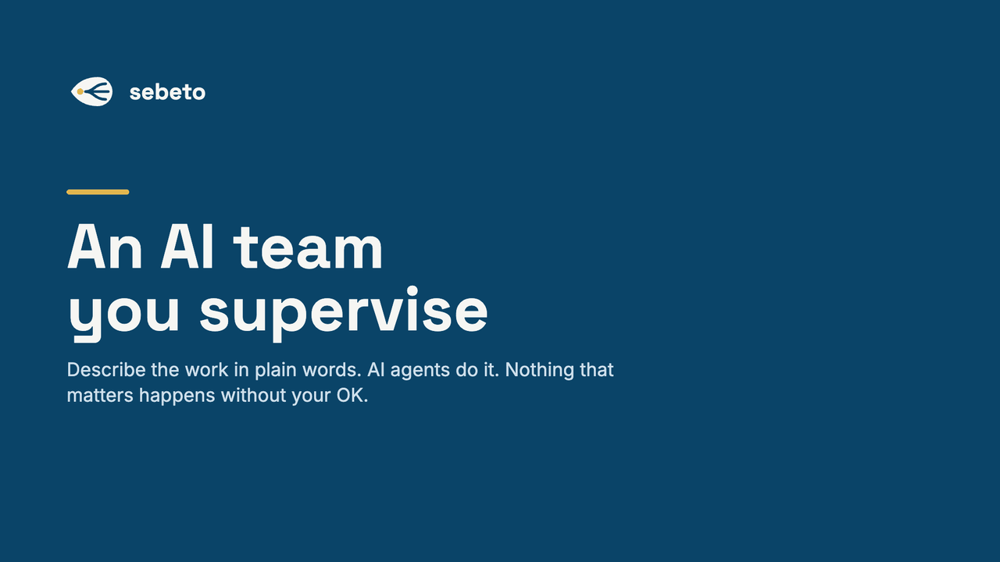

<p align="center"></p>

# Sebeto

*Speak, and your team gets to work.*

**An AI team orchestrator that anyone can use.** Every ticket is an agent session: describe what you need, chat with the agent working on it, approve what it wants to do, and watch the card move from *Backlog* to *Completed*.

<p align="center"></p>
<p align="center"><sub>A 65-second tour. Screenshots from the demo mode (<code>?mock=1</code>) with made-up data, plus a real org chart.</sub></p>

> Status: **v0.8 (early, not yet released)**. Working today: the board and ticket sessions; agents on Claude Code, OpenAI Codex (ChatGPT subscription), local Ollama, and any OpenAI-compatible runtime (LM Studio, vLLM, OpenRouter) picked per agent or ticket; agents that delegate work to teammates (child tickets, permission-gated); the permission gate with request cards (Allow once / **Allow for this task** / Always allow → trusted commands / Deny); snapshots and Undo; a Gmail connector and "Sign in with Microsoft / Google"; **Jira & Confluence (Atlassian MCP) and Slack connectors**; agents on Claude Code that use **your own Claude connectors** (Atlassian, Slack, Gmail…), every call approved through Sebeto; the Chief of Staff intake chat; a connectors catalog with custom MCP servers; teams and routing (DevOps, Red Team); triggers (webhooks, mail rules, schedules, **Slack channels** (through a Slack app or your own Claude Slack connector), **Jira JQL**); an append-only security log with Emergency stop; an Obsidian-compatible memory vault; a cost dashboard; add budget from the ticket; **Deleted tickets** (restore or delete forever); light/dark theme; workspace backup and restore; and resilient local agents (a stuck local model pivots with an advisor model). The desktop app and the container setup work. See [docs/06 Roadmap.md](docs/06%20Roadmap.md). Installers for Windows, macOS and Linux are built and smoke-tested by CI (unsigned for now). Next: Skills v1 (portable SKILL.md) and a first public release.

## Try it (developers)
Requires [Node.js 22+](https://nodejs.org) and Git. Works in PowerShell, cmd, macOS and Linux terminals.
```bash
git clone https://github.com/vincenzosomma/sebeto-oss.git
cd sebeto-oss
npm install
npm run build
npm start
```
`npm start` prints an address like `http://127.0.0.1:7600/?token=…`. Open it in your browser.
It starts with the **test agent** (no AI, free) and, if [Claude Code](https://claude.com/claude-code) is installed and logged in, the **Claude agent**. Your data is stored in `~/.sebeto/workspace`.
To keep the same address after a restart (and other settings such as `SEBETO_OLLAMA_PIVOT_MODEL`), put `SEBETO_TOKEN=<at least 16 characters>` in `~/.sebeto/sebeto.env` (one `SEBETO_NAME=value` per line; keep the file private).

Just want to see the board with sample data? Run `npm run dev:ui` and open `http://localhost:5173/?mock=1`.
More in [docs/18 Development Guide.md](docs/18%20Development%20Guide.md).

## Why
Tools like herdr, Vibe Kanban and Conductor orchestrate agents well, but only for developers in a terminal or a git workflow. Sebeto targets **everyday work** (reports, documents, spreadsheets, files, research) for people who will never open a terminal.

## Key ideas
- **Board:** Backlog → In progress → **Needs you** → Blocked → Completed. Statuses update automatically from what the agents do.
- **Chief of Staff:** a sidebar agent that turns a plain-language request (or a template) into a well-formed ticket.
- **Agents team:** agents organised like a company (inspired by [Paperclip](https://github.com/paperclipai/paperclip)), with roles, managers, monthly budgets that stop the agent or only warn (your choice), sub-tickets, and check-in schedules.
- **Safety first:** per-agent permissions (Allow / Ask / Never), sandboxed folders per ticket, snapshots with Undo, and cost caps.
- **Your Claude connectors:** agents on Claude Code can use the connectors you already have in Claude (Jira and Confluence, Slack, Gmail, Google Calendar…) with your login. Turn them on per agent, per team or for all agents; an agent that needs one asks you on the ticket. Every call still needs your OK: look-ups once per ticket, changes every time.
- **Search everything:** across ticket titles and full chat history, by exact words or by meaning.
- **Any model, your choice:** Claude (through the Claude Code CLI now, the Agent SDK later), Codex, Gemini, and local models via Ollama or LM Studio, picked per agent or per ticket.

## Your data stays yours
Sebeto runs **entirely on your own hardware**: as a desktop app on your computer, or (planned) as a Docker container on your own server. There is no account, no Sebeto server, and no telemetry. Your tickets, chats and files never touch our servers, because we don't have any. When you use a cloud AI model, requests go directly from your machine to that provider under your own account. For full privacy, use a local model with Ollama or LM Studio.

## Repo layout
| Path | Contents |
|---|---|
| `docs/` | Technical docs: architecture, runtimes, connectors, security, roadmap |
| `design/mockup/` | Interactive mockup source (`.dc.html` design-canvas files) |
| `packages/shared` | Shared types and contracts |
| `packages/core` | The headless core: API, agents, permissions, snapshots, storage |
| `packages/ui` | The React board |
| `apps/desktop` | The Electron desktop app |
| `docker/` | Container image and compose file |

## Planned stack
Headless TypeScript core with an HTTP/WebSocket API · React UI · desktop app (Electron) and Docker image · SQLite (FTS5) · pluggable runtime adapters: the Claude Code CLI now, the Claude Agent SDK, Codex, Gemini and Ollama next. Every ticket is one agent session, and users choose the model per agent or per ticket. See [docs/09 Runtimes & Sessions.md](docs/09%20Runtimes%20%26%20Sessions.md). See [docs/05 Architecture.md](docs/05%20Architecture.md).

## Contributing
See [CONTRIBUTING.md](CONTRIBUTING.md).

## The name
The **Sebeto** (seh-BEH-toh) is the ancient river of Naples. The city was built over it, yet it still flows underground, unseen, keeping Naples alive. Parthenope founded the city; the Sebeto keeps it alive. Sebeto does the same for your work.

## License
[MIT](LICENSE)
